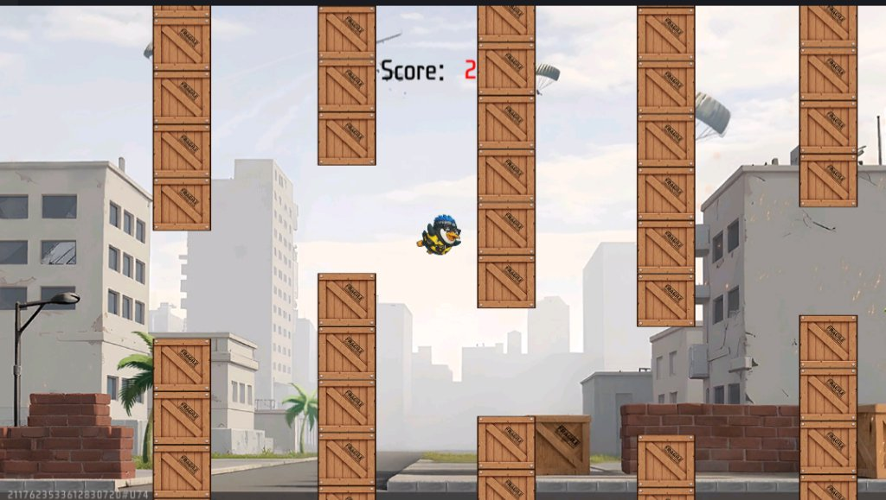
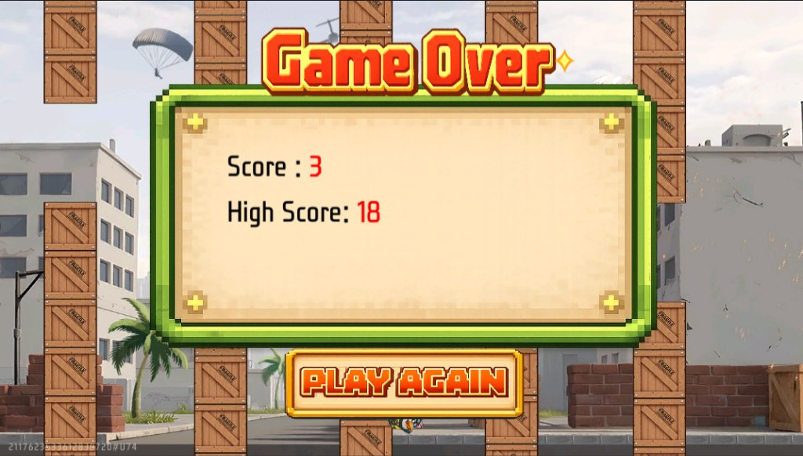

# Flappy Bird UGC — Custom Physics & Procedural Arcade Game

Tựa game Flappy Bird kinh điển được tái hiện lại trên nền tảng **Garena Craftland Studio**, sử dụng ngôn ngữ lập trình hướng đối tượng tĩnh **FCG** (Free Fire Craftland Scripting Language).

Dự án tập xây dựng toàn bộ mô hình vật lý rơi tự do, hệ sinh chướng ngại vật động với mẫu thiết kế UI, kiến trúc phân tách **Client - Server**, và hệ thống lưu trữ bảng xếp hạng trực tuyến.

---

## Hình Ảnh Trò Chơi (Gameplay & UI)

| GamePlay | Game Over |
| :---: | :---: |
|  |  |

---

## Các Tính Năng Kỹ Thuật Chính

### 1. Mô Phỏng Động Học & Vật Lý Cá Nhân Hóa (`BirdPhysics.fcg`)
- **Vật lý trọng lực tự xây dựng:** Tự tính toán gia tốc trọng trường (`gravity * BirdSpeedMultiplier`) và vận tốc nhảy tức thời (`jumpForce`) độc lập trên client để đảm bảo phản hồi tức thì (Zero-latency input).
- **Hệ thống va chạm (Collision Detection):** Tính toán va chạm hộp bao (Bounding Box / AABB) giữa tọa độ của chim với ống trên, ống dưới và mặt đất.
- **Trạng thái đóng băng (Freeze Frame) & Hiệu ứng tử vong:** Cơ chế dừng hình thoáng chốc khi va chạm trước khi chim rơi tự do xuống đất và kích hoạt âm thanh / giao diện Game Over.
- **Quản lý Animation Frame:** Luân chuyển liên tục các khung hình hoạt ảnh (3-frame animation) dựa trên timer nội bộ.

### 2. Hệ Sinh Chướng Ngại Vật & Object Pooling (`PipeSystem.fcg`)
- **Mẫu thiết kế Object Pooling:** Khởi tạo trước một tập hợp 5 ống (`poolSize = 5`) và tái chế liên tục khi ống bay vượt khỏi màn hình thay vì liên tục tạo mới/hủy đối tượng trong vòng lặp game.
- **Sinh địa hình ngẫu nhiên:** Thuật toán tính toán vị trí trục Y và khoảng hở (`gapSize`) ngẫu nhiên cho từng cặp ống khi kích hoạt lại.
- **Cơ chế tính điểm tự động:** Kiểm tra vị trí x của từng ống so với chim để cộng điểm chính xác một lần duy nhất cho mỗi chướng ngại vật vượt qua.

### 3. Vòng Lặp Trò Chơi & Quản Lý Trạng Thái (`GameManager.fcg`)
- **Điều phối Game Loop:** Đóng vai trò Controller chính, kết nối và gọi hàm cập nhật thủ công (`ManualUpdate`) tới hệ thống vật lý và hệ thống ống mỗi khung hình.
- **Ánh xạ Widget linh hoạt:** Sử dụng API `Hud.GetWidgetByPath` để bóc tách và điều khiển toàn bộ cấu trúc cây giao diện (UI Tree) động từ tệp giao diện `flappybird.ui`.
- **Máy trạng thái đơn giản (State Machine):** Chuyển đổi mượt mà giữa các trạng thái: Chờ bắt đầu (Tutorial/Idle) $\to$ Đang chơi (In-Game) $\to$ Kết thúc (Game Over).

### 4. Đồng Bộ & Lưu Trữ Bảng Xếp Hạng Server (`ServerData.fcg`)
- **Phân tách Client/Server:** Mã client (`[platform_client]`) xử lý hoàn toàn trải nghiệm đồ họa và gameplay mượt mà; mã server (`[platform_server]`) chịu trách nhiệm xác thực điểm số.
- **Lưu trữ dữ liệu đám mây (Cloud Database):** Kết nối với API Leaderboard (`ReadFromLeaderboard`, `WriteToLeaderboard`) để lưu điểm cao nhất (`highScore`) theo định danh người chơi (`UserUID`).
- **Truyền tin liên nền tảng:** Sử dụng `DispatchEventToEntity` để đồng bộ điểm số kỷ lục từ Server về Client khi có người chơi phá kỷ lục.

---

## 📂 Cấu Trúc Dự Án

```text
├── Assets/
│   ├── Script/
│   │   └── FCG/
│   │       ├── BirdPhysics.fcg     # Mô phỏng vật lý rơi, nhảy và va chạm
│   │       ├── PipeSystem.fcg      # Hệ thống ống và Object Pooling pattern
│   │       ├── GameManager.fcg     # Quản lý vòng lặp game và cây UI Widget
│   │       ├── ServerData.fcg      # Xử lý Server & lưu trữ Leaderboard
│   │       ├── InputHandler.fcg    # Bắt sự kiện chạm/click của người chơi
│   │       └── Replay_Button.fcg   # Xử lý nút chơi lại
│   ├── flappybird.ui               # Tệp bố cục giao diện đồ họa
│   ├── Scene/                      # Tài nguyên màn chơi Craftland
│   └── ECA/                        # Event-Condition-Action assets
├── screenshots/                    # Ảnh chụp gameplay thực tế
│   ├── gameplay.jpg
│   └── gameover.jpg
├── fcconfig.json                   # Cấu hình biên dịch ngôn ngữ FCG
├── main.gproj                      # Tệp cấu hình dự án Craftland Studio
└── README.md
```

---

## 🛠️ Công Nghệ Sử Dụng

- **Engine:** Garena Craftland Studio (UGC Platform).
- **Ngôn ngữ:** FCG (Free Fire Craftland Scripting Language - OOP, Static Typing).
- **Mô hình kiến trúc:** Client-Server Separation, Object Pool Pattern, Event-Driven Architecture.
